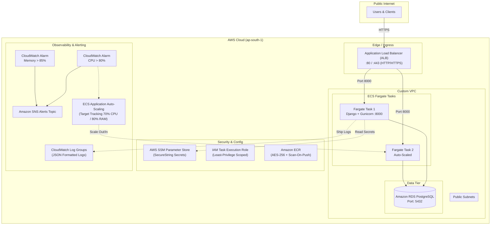

# Production-Grade Django ECS GitOps Platform

[](https://github.com/MelvinjoseC/django-ecs-gitops/actions/workflows/ci-cd.yml)
[](https://www.terraform.io/)
[](https://aws.amazon.com/ecs/)
[](https://www.docker.com/)
[](https://www.python.org/)

An enterprise-ready, production-grade Django REST API platform engineered for AWS ECS Fargate with automated resource scaling, zero-trust network hardening, structured CloudWatch observability, and GitOps CI/CD automation via GitHub Actions.

---

## Architecture Overview



---

## Senior DevOps Engineering Standards

### 1. Hardened Multi-Stage Containerization
* **Isolated Build vs Runtime:** Multi-stage Docker build isolates compilers (`gcc`, `libpq-dev`) into the builder stage, producing a lightweight, secure runner container.
* **Non-Root Execution:** The application executes under a dedicated system user (`appuser`, UID 10001) with a disabled shell (`/sbin/nologin`).
* **Curl-Free Lightweight Health Checks:** Uses native Python `urllib.request` to test application and database readiness, eliminating external binary vulnerabilities.
* **Tuned WSGI Server:** Configured with `gunicorn.conf.py` supporting worker recycling (`max_requests`), thread pooling, and standard output streaming.

### 2. Infrastructure as Code (Terraform 1.7+)
* **Fully Modularized Architecture:** Split into dedicated components (`provider.tf`, `ecr.tf`, `iam.tf`, `security_groups.tf`, `alb.tf`, `ecs.tf`, `autoscaling.tf`, `monitoring.tf`, `variables.tf`, `outputs.tf`).
* **Zero-Trust Security Groups:** Ingress to ECS tasks is strictly locked down to the ALB security group on port 8000.
* **Least-Privilege IAM:** IAM Task Execution Role is scoped exclusively to the specific ARNs of SSM Parameter Store secrets.
* **ECR Governance:** Automatic vulnerability scanning on image push, AES-256 encryption at rest, and lifecycle policies expiring untagged artifacts after 14 days.
* **High Availability & Autoscaling:** Dual-metric Target Tracking autoscaling based on CPU (70%) and Memory (80%) thresholds.

### 3. Application Security & Observability
* **Security Middleware:** Strict SSL redirection, HSTS with preload (`31536000s`), secure cookies (`SESSION_COOKIE_SECURE`, `CSRF_COOKIE_SECURE`), and `X-Frame-Options: DENY`.
* **Structured JSON Logging:** Native integration with `python-json-logger` emitting machine-readable logs to AWS CloudWatch.
* **Deep Health Checking:** `/api/health/` verifies application responsiveness and active database connection pool health.

---

## Repository Structure

```text
├── .github/
│   └── workflows/
│       └── ci-cd.yml            # Production GitOps CI/CD pipeline
├── app/
│   ├── api/                     # REST API views, serializers, models, and tests
│   │   └── tests/               # Unit & integration test suites
│   └── core/                    # Django settings, WSGI, and URL routing
├── scripts/
│   ├── setup_secrets.sh         # Interactive AWS SSM Parameter Store bootstrapping
│   ├── validate.sh              # Local pre-push verification script
│   └── destroy_infra.sh         # Safe infrastructure decommissioning script
├── terraform/                   # Enterprise Modular Infrastructure as Code
│   ├── alb.tf                   # Application Load Balancer & Target Groups
│   ├── autoscaling.tf           # ECS Auto-Scaling target & policies
│   ├── backend.tf.example       # S3 Remote state and DynamoDB locking template
│   ├── ecr.tf                   # Amazon ECR repository & lifecycle policies
│   ├── ecs.tf                   # ECS Cluster, Task Definition & Service
│   ├── iam.tf                   # Scoped IAM roles and policies
│   ├── monitoring.tf            # CloudWatch log groups, alarms, and SNS topic
│   ├── outputs.tf               # Terraform output definitions
│   ├── provider.tf              # AWS Provider configuration and global tags
│   ├── security_groups.tf       # Security group firewall rules
│   ├── terraform.tfvars.example # Example variable definitions
│   └── variables.tf             # Input variables with validation rules
├── .dockerignore                # Production build exclusion rules
├── .env.example                 # Local environment template
├── .pre-commit-config.yaml      # Git pre-commit hook definitions
├── docker-compose.yml           # Local multi-container development stack
├── Dockerfile                   # Multi-stage hardened production container
├── gunicorn.conf.py             # Enterprise Gunicorn configuration
├── Makefile                     # Developer productivity commands
├── pytest.ini                   # Pytest test discovery settings
├── requirements.txt             # Production dependencies
└── setup.cfg                    # Flake8 and linter configuration
```

---

## Local Development Quickstart

### Prerequisites
* Docker & Docker Compose
* Python 3.11+
* Terraform 1.7+

### 1. Spin up Local Stack
```bash
# Clone repository
git clone https://github.com/MelvinjoseC/django-ecs-gitops.git
cd django-ecs-gitops

# Create local environment configuration
cp .env.example .env

# Launch PostgreSQL, Django REST API, and pgAdmin
docker compose up -d --build
```

### 2. Access Endpoints
* **Task REST API:** `http://localhost:8000/api/tasks/`
* **Deep Health Check:** `http://localhost:8000/api/health/`
* **pgAdmin Console:** `http://localhost:5050/` (User: `admin@example.com`, Pass: `admin`)

### 3. Developer Workflows via Makefile
```bash
make help         # View all developer commands
make lint         # Run flake8 compliance checks
make format       # Format codebase using Black
make test         # Execute pytest test suite
make coverage     # Generate code coverage reports
make tf-fmt       # Format Terraform configuration
make tf-validate  # Validate Terraform configuration
```

---

## AWS Deployment Runbook

### Step 1: Bootstrap Secrets in AWS SSM
Execute the automated provisioning script to store secure strings in AWS Systems Manager:
```bash
chmod +x scripts/*.sh
./scripts/setup_secrets.sh
```

### Step 2: Configure Remote State & Variables
```bash
cd terraform
cp backend.tf.example backend.tf
cp terraform.tfvars.example terraform.tfvars
# Update terraform.tfvars with your VPC, Subnets, and SSM Parameter ARNs
```

### Step 3: Provision Infrastructure
```bash
terraform init
terraform plan -out=tfplan
terraform apply tfplan
```

### Step 4: Decommissioning
To safely tear down all AWS resources and clean up SSM parameters:
```bash
./scripts/destroy_infra.sh
```

---

## CI/CD GitOps Pipeline Architecture

The GitHub Actions pipeline (`.github/workflows/ci-cd.yml`) automates validation, security inspection, and deployments:

| Job | Stage | Actions & Verifications |
| :--- | :--- | :--- |
| **1. Test & Lint** | Quality Gate | Runs `flake8`, executes Django migrations on ephemeral PostgreSQL, runs `pytest` with coverage report (`--fail-under=70`). |
| **2. IaC Lint** | Infrastructure Gate | Verifies `terraform fmt -check`, runs `tflint`, and executes `tfsec` security vulnerability scans. |
| **3. Build & Scan** | Security Gate | Compiles Docker container, runs **Aqua Security Trivy** vulnerability scanning for CRITICAL CVEs, and pushes tagged image to ECR. |
| **4. Terraform** | GitOps IaC Apply | Configures AWS credentials via OIDC, plans and applies infrastructure updates predictably. |
| **5. Deploy** | Zero-Downtime Release | Runs database migrations via one-off ECS Fargate task, triggers rolling deployment, and waits for service stability. |
| **6. Notify** | Observability | Publishes Slack deployment status notifications. |

---

## Required GitHub Actions Secrets

Configure these secrets in **GitHub Repository Settings → Secrets and variables → Actions**:

| Secret Key | Description |
| :--- | :--- |
| `AWS_ACCESS_KEY_ID` | IAM deployment user access key (or configure AWS OIDC role) |
| `AWS_SECRET_ACCESS_KEY` | IAM deployment user secret access key |
| `SUBNET_ID` | VPC Subnet ID for the Fargate one-off migration task |
| `SECURITY_GROUP_ID` | Security group ID (`ecs_tasks_security_group_id` from Terraform outputs) |
| `SLACK_WEBHOOK_URL` | (Optional) Incoming Slack webhook URL for build status alerts |
