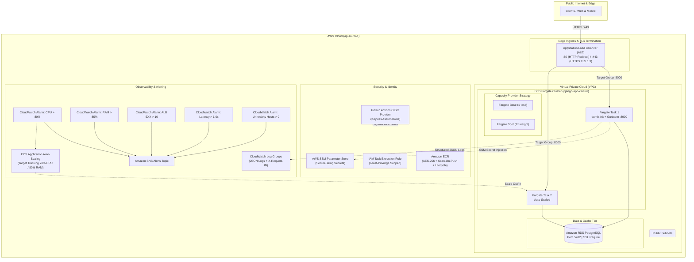

# Production-Grade Django ECS GitOps Platform

[](https://github.com/MelvinjoseC/django-ecs-gitops/actions/workflows/ci-cd.yml)
[](https://www.terraform.io/)
[](https://aws.amazon.com/ecs/)
[](https://www.docker.com/)
[](https://www.python.org/)
[](https://swagger.io/specification/)
[](https://github.com/astral-sh/ruff)

An enterprise-grade Django REST API platform engineered for AWS ECS Fargate featuring automated zero-downtime rolling deployments, Fargate Spot cost optimization, zero-trust network boundaries, structured CloudWatch observability, OpenAPI 3.0 documentation, and keyless GitOps CI/CD automation via GitHub Actions OIDC.

---

## Architecture Overview



---

## Senior Engineering Architectural Highlights

### 1. Hardened Multi-Stage Container & Process Supervision
* **Process Supervisor (`dumb-init`):** Operates as PID 1 to properly handle `SIGTERM` and `SIGINT` signals dispatched by AWS ECS during task drains, preventing hard-kills and connection drops.
* **Non-Root Execution:** Enforces least-privilege using system user `appuser` (UID 10001, GID 10001) with `/sbin/nologin`.
* **Split Health Checks:** Distinguishes between shallow container liveness (`/api/health/live/`) and deep database readiness (`/api/health/ready/`).
* **Optimized Multi-Stage Caching:** Separates compilation packages (`gcc`, `libpq-dev`) from minimal runtime packages (`libpq5`, `dumb-init`).

### 2. Infrastructure as Code & Cost Optimization (Terraform 1.7+)
* **Fargate Spot Integration:** Cluster capacity provider strategy combines standard `FARGATE` for baseline tasks with `FARGATE_SPOT` (weight 2) for up to 70% compute savings.
* **Deployment Circuit Breaker:** Configured with `deployment_circuit_breaker { enable = true, rollback = true }` for automated rollback on task startup failures.
* **TLS 1.3 Termination & 301 Redirection:** Configurable ACM SSL termination with policy `ELBSecurityPolicy-TLS13-1-2-2021-06` and automatic HTTP-to-HTTPS redirection.
* **Target Group Health Check Tuning:** Deregistration delay lowered to 30s with 15s health check intervals for fast ECS task transitions.
* **Full Observability Suite:** Automated CloudWatch metric alarms for CPU, Memory, ALB 5XX error count, Target Response Time latency (>1.0s), and UnHealthyHostCount (>0).

### 3. Application Security, Resilience & API Standards
* **Distributed Tracing (`X-Request-ID`):** Custom middleware generates or preserves correlation IDs, attaching them to HTTP response headers and structured CloudWatch JSON log entries.
* **Database Connection Resilience:** Configured with `CONN_HEALTH_CHECKS: True`, SSL modes (`require`/`prefer`), and automated connection lifecycle timeouts.
* **CORS & Security Headers:** `django-cors-headers` integration with environment-controlled origins, HSTS Preload (`31536000s`), and secure cookie flags.
* **OpenAPI 3.0 Documentation:** Automated schema generation via `drf-spectacular` serving interactive Swagger UI and Redoc.
* **Rate Limiting & Defensive Pagination:** DRF throttling rates (`120/min` anonymous, `600/min` authenticated) and bounded `StandardResultsSetPagination`.

---

## API Endpoints Reference

| Method | Endpoint | Description | Auth / Throttle |
| :--- | :--- | :--- | :--- |
| `GET` | `/api/health/live/` | Shallow container liveness probe | Public / No Throttle |
| `GET` | `/api/health/ready/` | Deep database connectivity & latency probe | Public / No Throttle |
| `GET` | `/api/health/` | Legacy health endpoint (target group alias) | Public / No Throttle |
| `GET` | `/api/schema/` | OpenAPI 3.0 YAML/JSON specification | Public |
| `GET` | `/api/docs/` | Interactive Swagger UI API documentation | Public |
| `GET` | `/api/redoc/` | Interactive Redoc API documentation | Public |
| `GET` | `/api/tasks/` | List tasks (supports search, ordering, pagination) | Throttled (120/min) |
| `POST` | `/api/tasks/` | Create a new task | Throttled (120/min) |
| `GET` | `/api/tasks/{id}/` | Retrieve task details | Throttled (120/min) |
| `PUT` | `/api/tasks/{id}/` | Replace task | Throttled (120/min) |
| `PATCH` | `/api/tasks/{id}/` | Update task status or fields | Throttled (120/min) |
| `DELETE` | `/api/tasks/{id}/` | Remove task | Throttled (120/min) |

---

## Repository Structure

```text
├── .github/
│   └── workflows/
│       └── ci-cd.yml            # Hardened GitOps pipeline with OIDC, Buildx, and Smoke Tests
├── app/
│   ├── api/                     # REST API views, serializers, models, pagination, and tests
│   │   ├── pagination.py        # Bounded page-size pagination
│   │   ├── tests/               # Pytest suite (health, tasks, cors, docs, middleware, db)
│   │   ├── views.py             # Split health probes and task viewsets
│   │   └── urls.py              # API router registrations
│   └── core/                    # Django core settings, WSGI, and middleware
│       ├── middleware.py        # X-Request-ID correlation tracking
│       ├── settings.py          # Hardened Django 4.2 settings
│       └── urls.py              # Root router + OpenAPI Swagger endpoints
├── scripts/
│   ├── setup_secrets.sh         # Interactive AWS SSM Parameter Store bootstrapping
│   ├── validate.sh              # Local pre-push validation script (Ruff, Flake8, Pytest)
│   └── destroy_infra.sh         # Safe infrastructure decommissioning script
├── terraform/                   # Enterprise Modular Infrastructure as Code
│   ├── alb.tf                   # Application Load Balancer, Target Groups & HTTPS Listener
│   ├── autoscaling.tf           # ECS Auto-Scaling target & policies
│   ├── backend.tf.example       # S3 Remote state and DynamoDB locking template
│   ├── ecr.tf                   # Amazon ECR repository & lifecycle policies
│   ├── ecs.tf                   # ECS Cluster, Fargate Spot, Task Definition & Circuit Breaker
│   ├── iam.tf                   # Scoped IAM roles and policies
│   ├── monitoring.tf            # CloudWatch log groups, 5 alarms, and SNS topic
│   ├── outputs.tf               # Terraform output definitions
│   ├── provider.tf              # AWS Provider configuration and global tags
│   ├── security_groups.tf       # Zero-trust security group firewall rules
│   ├── terraform.tfvars.example # Example variable definitions
│   └── variables.tf             # Input variables with validation rules
├── .dockerignore                # Production build exclusion rules
├── .env.example                 # Local environment template (includes Redis, CORS, SSL)
├── .pre-commit-config.yaml      # Git pre-commit hook definitions
├── docker-compose.yml           # Local multi-container development stack (Django + Postgres + Redis)
├── Dockerfile                   # Multi-stage container with dumb-init process supervisor
├── gunicorn.conf.py             # Enterprise Gunicorn configuration
├── Makefile                     # Developer productivity commands
├── pyproject.toml               # Modern Ruff, Black, Pytest, and Coverage tool configurations
├── pytest.ini                   # Pytest test discovery settings
├── requirements.txt             # Production dependencies
└── setup.cfg                    # Flake8 and linter configuration
```

---

## Local Development Quickstart

### Prerequisites
* Docker & Docker Compose V2
* Python 3.11+
* Terraform 1.7+

### 1. Spin up Local Multi-Container Stack
```bash
# 1. Clone repository
git clone https://github.com/MelvinjoseC/django-ecs-gitops.git
cd django-ecs-gitops

# 2. Configure local environment
cp .env.example .env

# 3. Launch PostgreSQL, Redis, Django API, and pgAdmin
docker compose up -d --build
```

### 2. Verify Endpoints
* **Interactive Swagger UI:** `http://localhost:8000/api/docs/`
* **Redoc Documentation:** `http://localhost:8000/api/redoc/`
* **Shallow Liveness Probe:** `http://localhost:8000/api/health/live/`
* **Deep Database Readiness:** `http://localhost:8000/api/health/ready/`
* **Task REST API:** `http://localhost:8000/api/tasks/`
* **pgAdmin Console:** `http://localhost:5050/` (`admin@example.com` / `admin`)

### 3. Developer Workflows via Makefile
```bash
make help         # View all developer commands
make ruff         # Run fast Ruff linter
make lint         # Run flake8 compliance checks
make format       # Format codebase using Black and Ruff
make test         # Execute pytest test suite
make coverage     # Generate code coverage reports
make tf-fmt       # Format Terraform configuration
make tf-validate  # Validate Terraform configuration
make smoke-test   # Run local HTTP health probe verification
```

---

## CI/CD GitOps Pipeline Architecture

The GitHub Actions workflow (`.github/workflows/ci-cd.yml`) automates verification, security auditing, and continuous deployment:

| Stage | Job | Actions & Verifications |
| :--- | :--- | :--- |
| **Quality Gate** | `test` | Sets up Python 3.11 with pip caching, runs `flake8`, executes Django migrations against ephemeral Postgres 15, executes `pytest` with coverage report (`--fail-under=70`). |
| **IaC Gate** | `terraform-lint` | Verifies `terraform fmt -check`, executes `tflint`, and runs `tfsec` static security scans. |
| **Security Gate** | `build-and-push` | Compiles container using Docker Buildx with GitHub Actions layer cache (`type=gha`), runs **Aqua Security Trivy** vulnerability scanning for CRITICAL CVEs, and pushes tagged image to ECR. |
| **GitOps IaC** | `terraform` | Authenticates keylessly via AWS GitHub Actions OIDC role, plans and applies infrastructure changes. |
| **Deployment Gate** | `deploy` | Runs database migrations via one-off Fargate task with verification gate (waiting for exit code 0), triggers rolling service update, and performs automated post-deployment health smoke test against the live ALB endpoint. |
| **Observability** | `notify` | Dispatches deployment success or failure alerts to Slack. |

---

## AWS Deployment Runbook

### Step 1: Bootstrap Secrets in AWS SSM
Store production secrets securely in AWS Systems Manager Parameter Store:
```bash
chmod +x scripts/*.sh
./scripts/setup_secrets.sh
```

### Step 2: Configure AWS OIDC for Keyless GitHub Actions
Create an IAM Role with Web Identity Trust Policy for GitHub Actions:
```json
{
  "Version": "2012-10-17",
  "Statement": [
    {
      "Effect": "Allow",
      "Principal": {
        "Federated": "arn:aws:iam::<ACCOUNT_ID>:oidc-provider/token.actions.githubusercontent.com"
      },
      "Action": "sts:AssumeRoleWithWebIdentity",
      "Condition": {
        "StringEquals": {
          "token.actions.githubusercontent.com:aud": "sts.amazonaws.com"
        },
        "StringLike": {
          "token.actions.githubusercontent.com:sub": "repo:MelvinjoseC/django-ecs-gitops:*"
        }
      }
    }
  ]
}
```
Set the resulting role ARN in GitHub Secrets as `AWS_ROLE_ARN`.

### Step 3: Provision Infrastructure with Terraform
```bash
cd terraform
cp backend.tf.example backend.tf
cp terraform.tfvars.example terraform.tfvars
# Edit terraform.tfvars with your VPC, Subnets, and SSM Parameter ARNs
terraform init
terraform plan -out=tfplan
terraform apply tfplan
```

### Step 4: Disaster Recovery & Safe Decommissioning
To gracefully drain tasks and decommission all provisioned AWS cloud resources:
```bash
./scripts/destroy_infra.sh
```
